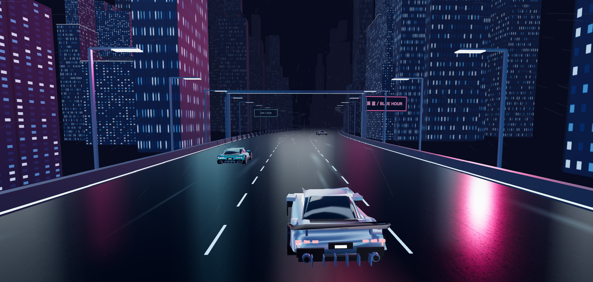
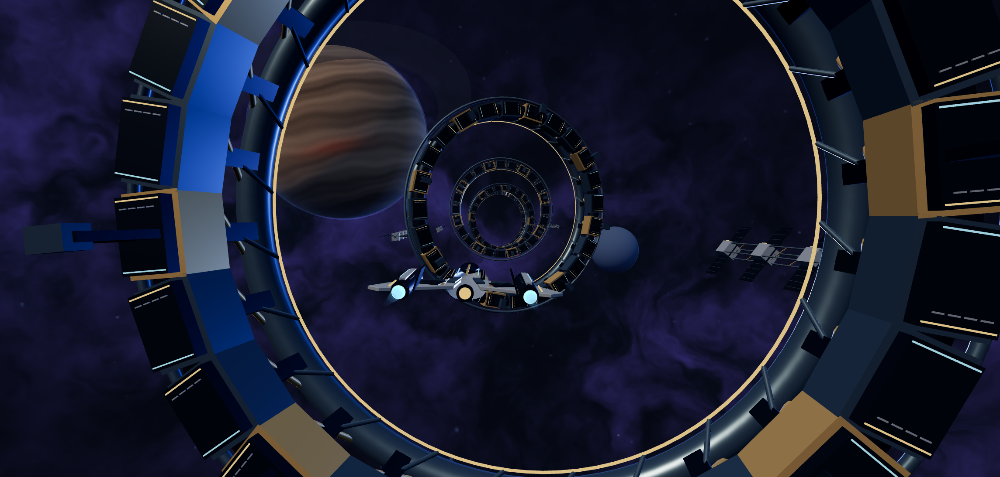
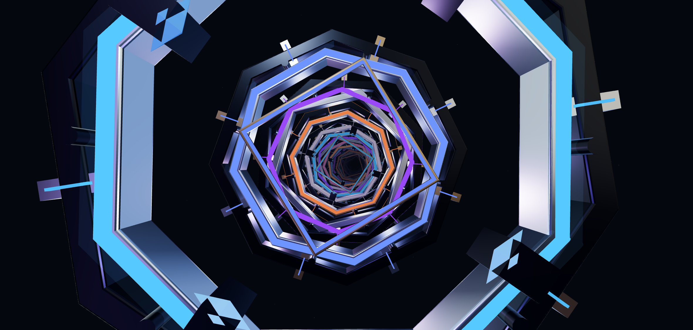
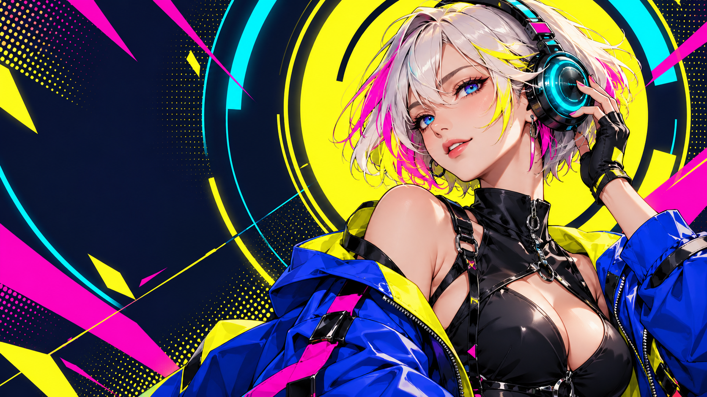
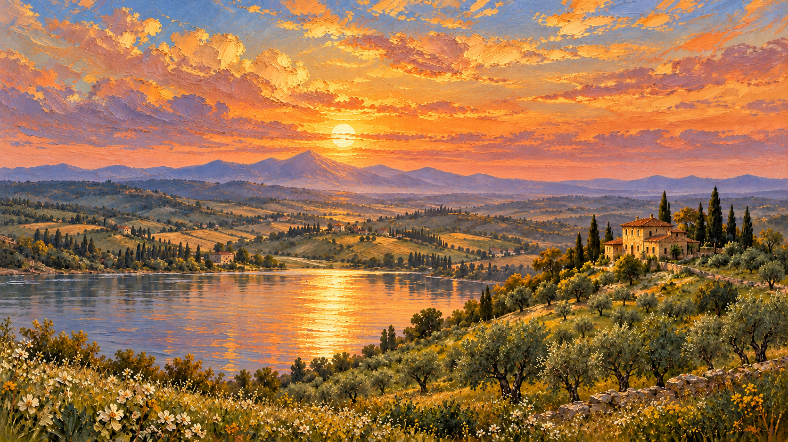

<div align="center">

# Stillscape · 静观

**让画面呼吸，让想象流动。**

A living wallpaper gallery — paintings, anime art, and real-time 3D worlds.

**26 款作品 · 统一播放器 · WebGL / Three.js · 纯静态部署**

[在线体验](https://stillscape-living-worlds-xc.opal-moon-2891.chatgpt.site) · [快速开始](#快速开始) · [作品与玩法](#作品与玩法) · [开发指南](#开发指南)

</div>



Stillscape 是一个在浏览器中运行的动态壁纸艺术集。它把绘画、动漫人物、超现实艺术与实时三维场景放进同一个画廊：既可以看湖水与云层缓缓流动，也可以跟随跑车驶过霓虹城市，或穿越深空环门。

不需要后端、数据库或运行时 API Key。下载项目后即可在本地启动；生产构建可以部署到静态网站托管服务。**这是网页作品集，不是操作系统桌面壁纸管理器，也不是 Wallpaper Engine 的扩展。**

## 先看这几款

| 午夜超驰 | 星环远征 | 棱镜回廊 |
| :---: | :---: | :---: |
| [](https://stillscape-living-worlds-xc.opal-moon-2891.chatgpt.site/?scene=23-midnight-overdrive) | [](https://stillscape-living-worlds-xc.opal-moon-2891.chatgpt.site/?scene=24-orbital-voyage) | [](https://stillscape-living-worlds-xc.opal-moon-2891.chatgpt.site/?scene=25-prism-corridor) |
| 跑车、弯道、车流与湿路反光 | 飞船、巨型环门与紫蓝星云 | 旋转机械环、彩光与连续穿行 |

| 电光心跳 | 绯月剑歌 | 托斯卡纳的呼吸 |
| :---: | :---: | :---: |
| [](https://stillscape-living-worlds-xc.opal-moon-2891.chatgpt.site/?scene=17-electric-idol) | [](https://stillscape-living-worlds-xc.opal-moon-2891.chatgpt.site/?scene=22-crimson-swordswoman) | [](https://stillscape-living-worlds-xc.opal-moon-2891.chatgpt.site/?scene=00-tuscany-reborn) |
| 鲜彩人物、耳机光环与动态图形 | 红月、飘叶与衣发局部微动 | 油画笔触、湖面水波与柏树风摆 |

> 三维作品的预览图来自实际运行画面的截帧；绘画与人物预览是原画。静态图片不展示完整动效，请进入在线体验查看。

## 有什么特别之处

- **三种表现方式**：分层绘画的 WebGL 动效、人物插画的局部形变与 Canvas 特效、由真实几何构成的三维穿行场景。
- **统一的观看体验**：每款作品共用返回、标题、时钟、播放、设置、收藏、沉浸、全屏和截帧控制。场景专属选项集中在设置面板。
- **可调节的运动**：速度为 0.25–3×；按场景提供 0–300% 动态强度，或风、水、云、光等独立参数。
- **便于发现与分享**：按风格筛选、关键词搜索、本地收藏，以及 `?scene=<id>` 直达某款作品。
- **部分场景有原创合成声景**：用户主动开启后播放；无声作品明确禁用声音按钮，不自动播放音频。
- **纯前端、自包含资源**：系统字体、本地素材、本地 Three.js；无需运行时 CDN、付费 API 或在线生成服务。

## 快速开始

建议使用 **Node.js 22 LTS** 和带硬件加速的现代浏览器。

```bash
git clone https://github.com/FightJs/stillscape.git
cd stillscape
npm ci
npm run dev
```

打开终端显示的本地地址，通常为 **http://localhost:5173/**。

```bash
# 构建生产版本，输出至 dist/
npm run build

# 在本地预览生产构建
npm run preview
```

不要直接双击 HTML 使用 `file://` 打开；模块加载、资源请求与浏览器音频能力需要 HTTP 环境。

## 作品与玩法

目前收录 **26 款**：16 款绘画与风景、6 款人物与幻想插画、4 款实时三维场景。

| 系列 | 作品 |
| --- | --- |
| 绘画艺术 | 托斯卡纳的呼吸、潮汐星原、纸间森林 |
| 东方意境 | 听山、松风潮汐 |
| 数字幻想 | 凌晨便利店、浮岛邮局、雨港第七码头、寂静的重量、月下温室 |
| 极简空间 | 呼吸之环 |
| 自然光影 | 盐蓝海岸、蓝色寂静、浅海回声、极夜信号、琥珀呼吸 |
| 人物与幻想 | 电光心跳、日冕机甲、月相魔女、超频街头、琉璃浮梦、绯月剑歌 |
| 实时三维 | 霓虹夜航、午夜超驰、星环远征、棱镜回廊 |

进入作品后，使用底部控制栏调整体验。霓虹夜航还提供雨幕、车体特写、飞行信息及视角复位；可在画面内拖动环视、滚轮缩放。

| 快捷键 | 操作 |
| --- | --- |
| `Space` | 暂停 / 继续 |
| `H` | 隐藏 / 恢复界面 |
| `F` | 切换全屏（依浏览器支持） |
| `M` | 切换环境声（有声作品） |
| `←` / `→` | 上一幅 / 下一幅 |
| `Esc` | 关闭对话框、恢复隐藏界面或返回作品集，取决于当前状态 |

收藏保存在当前浏览器的 `localStorage` 中，不会跨设备同步。PNG 截帧保存的是画面，不包含播放器控制界面。

## 会员计划与商务合作（占位）

画廊新增会员计划和商务合作入口，沿用现有视觉风格并适配移动端：

- **Explore**：展示现有免费体验，不改变作品浏览、收藏、动效控制或截帧功能。
- **Stillscape Plus**：展示筹备中的个人会员计划；价格、周期、权益和上线时间均待公布。
- **Stillscape Studio**：展示拟开展的品牌定制、空间展陈和作品商用授权方向；合作通道与联系方式尚未开放。

当前仅提供展示与说明弹窗，不含账号、支付、订阅、咨询提交或商用授权功能，不收集个人信息。个人会员不等于商用授权。正式开放前需确认权益、定价、合作方式与授权条款，并接入对应服务。

展示文案在 `index.html` 与 `gallery.html`，两份入口需同步维护；样式在 `commerce.css`，弹窗复用 `gallery.js` 的原生 dialog 交互。

## 技术实现

| 层级 | 实现 |
| --- | --- |
| 画廊与播放器 | HTML、CSS、原生 ES Modules |
| 绘画动效 | 自定义 WebGL shader、分层素材、独立运动时钟 |
| 人物动效 | Canvas 2D 图形 / 粒子与局部 WebGL 位移 |
| 三维场景 | Three.js r160，以及霓虹夜航的独立 WebGL 实现 |
| 环境声音 | Web Audio 程序合成 |
| 开发与构建 | Vite 6 |
| 嵌入通信 | sandbox iframe + 来源校验的 `postMessage` 协议 |

```text
stillscape/
├── index.html                    # 作品集入口
├── gallery.js / gallery.css      # 画廊、统一播放器与控制
├── scenes.js                     # 场景清单、资源路径与动效配置
├── engine.js                     # 绘画 WebGL 渲染引擎
├── motion-profiles.js             # 每幅作品的动效校准
├── soundscape.js                  # 程序化声景
├── public/
│   ├── wallpapers/               # 原画与三维真实截帧封面
│   ├── layers/                   # 分层运动素材
│   ├── experiences/              # 独立人物 / 三维展示器
│   │   └── wallpaper-bridge.js   # 统一播放器桥接协议
│   └── vendor/                   # 本地 Three.js 与第三方许可证
├── tests/                        # 浏览器技术与声景测试入口
├── scripts/                      # 评审元数据同步工具
├── docs/                         # 技术验证与素材来源
├── research/                     # 参考研究及可核验的来源链接
├── reviews/                      # 分轮评审记录与证据说明
└── production/                   # 创作记录与场景制作说明
```

## 开发指南

### 新增绘画场景

1. 将原画放入 `public/wallpapers/`，需要独立运动的素材放入 `public/layers/`。
2. 在 `scenes.js` 添加唯一 ID、标题、分类、封面与动效配置。现有场景可作为字段示例。
3. 按需在 `motion-profiles.js` 校准速度，并在 `gallery.js` 配置有效的控制项。
4. 进入作品检查默认动效、最高档、零强度、暂停恢复及截帧。

### 新增独立三维场景

将页面放入 `public/experiences/`，在场景清单中指定 `kind: 'embedded'` 和本地 `src`。通过经典脚本加载 `wallpaper-bridge.js`，在画面可用后注册：

```js
WallpaperBridge.register({
  setPlaying(playing) { /* 暂停或恢复动画时钟 */ },
  setSettings({ speed, power }) { /* 应用有效参数 */ },
  reset() { /* 复位镜头或场景 */ },
  snapshot() { /* 同步渲染后返回 PNG data URL */ },
  getState() { return { playing: true }; }
});
```

示例仅展示接口形状，`getState()` 应返回实际播放状态。`embed=1` 时隐藏页面自有控件，交由宿主播放器控制。宿主只接受当前 iframe 的消息，子页只接受父页面控制；退出作品会移除 iframe。不要为了加载图片移除隔离设置，人物展示器已提供宿主传递图像的实现示例。

## 验证与已知边界

```bash
npm run build
```

开发服务器启动后，还可打开：

- `/tests/technical-qa.html`：绘画场景的加载、运动时钟、暂停、导出及资源释放测试。
- `/tests/audio-collection.html`：声景检查入口；播放前请调整到舒适音量。

历史验证记录分开保存，避免把某一轮的结论当作所有版本的保证：

- [绘画引擎技术检查](docs/MOTION-TECHNICAL-QA.md)：记录当时 16 款绘画场景的 171 项断言；不覆盖新增三维场景。
- [统一播放器与三维场景复验](reviews/unified-motion-review.md)：包含实际浏览器观察、首轮问题及第二轮修复。
- [人物系列评审](reviews/character-review.md)：区分功能验收与艺术评分，不把功能通过写成获奖认证。

横屏是主要构图方向。原画大多为 1672×941，部分尺寸不同；绘画引擎的 3840×2160 PNG 导出是合成放大，不代表原画原生 4K。独立场景截图分辨率由渲染画布决定。性能取决于 GPU、浏览器和窗口尺寸，项目不承诺所有设备固定 60 FPS。低性能设备可降低速度或强度、暂停，或选择较轻的场景。

## 部署

运行 `npm ci && npm run build`，将 **`dist/` 的内容**发布到静态托管服务。无需后端、数据库或环境变量。

资源路径目前按**域名根目录 `/`**组织。托管到根域名或独立子域名最直接；如果要部署到 GitHub Pages 的 `/仓库名/` 子路径，还需要统一修改 Vite base、场景资源路径与 iframe 路径，不能只改一个 base 就假定所有场景可用。

仓库提供 GitHub Actions 构建检查，不会自动覆盖现有在线站点。网站内容更新后需要重新构建并发布。

## 素材、参考与许可

绘画和人物原画使用 AI 图像生成工具创作，三维新作使用程序化几何与材质；霓虹夜航由项目发起者提供并整合。素材来源见 [ASSETS.md](docs/ASSETS.md)，强动态参考研究见 [Steam Workshop 研究](research/steam-motion-2026-10-28.md)。参考链接用于分析风格和运动机制，未下载分发参考作品。

本仓库目前未对自有代码、生成图像及用户提供内容授予统一开源许可证；公开可见不等于自动授予商业复用权。复用或商业使用前请确认对应授权。第三方依赖保留各自许可，其中 Three.js 使用 [MIT License](public/vendor/THREE-LICENSE.txt)。

## 反馈

欢迎通过 Issues 提供建议或报告问题。为便于复现，请附上作品名称、浏览器与系统、操作步骤、预期效果和实际表现；涉及性能时可补充窗口尺寸与硬件信息。避免在截图或日志中包含个人信息、令牌或账户凭据。
